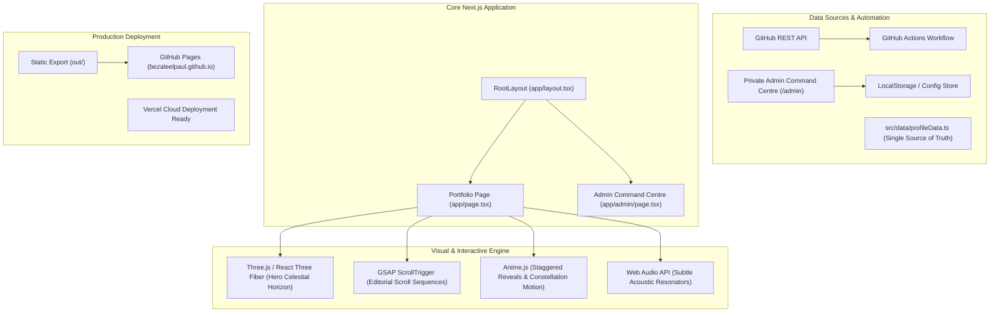

# System Architecture Document
**Project:** Cinematic Interstellar Portfolio & Digital Resume  
**Target:** `BezaleelPaul/bezaleelpaul.github.io`  
**Version:** 3.0.0-production  

---

## 1. High-Level System Architecture



---

## 2. Technology Stack & Decision Matrix

| Layer | Selected Technology | Justification & Architectural Boundary |
| :--- | :--- | :--- |
| **Framework** | **Next.js 14 (App Router)** | Component-based architecture, optimized static bundling, fast SSR/SSG, and native TypeScript support. |
| **Language** | **TypeScript 5.x** | Strict typing for GitHub data structures, project taxonomies, simulation parameters, and UI states. |
| **Styling** | **Tailwind CSS 3.4** | Design-token-driven typography, editorial color palettes (Deep Space Black, Midnight Navy, Electric Cyan), and responsive grid layouts. |
| **3D Engine** | **Three.js & React Three Fiber** | Constrained to the **Hero Celestial Horizon** and **Interactive Constellations**. No game mechanics or physics bloat. |
| **Animation: Scroll** | **GSAP & ScrollTrigger** | High-performance scrubbed scroll timelines and editorial section reveals. Strictly no scroll-jacking. |
| **Animation: Micro** | **Anime.js** | Letter-by-letter kinetic headlines, constellation SVG connector lines, and subtle hover mechanics. |
| **Audio** | **Procedural Web Audio API** | Zero-bandwidth acoustic soundscape (40Hz deep hum, 880Hz soft telemetry blip), 100% user-consented with instantaneous mute toggle. |
| **Icons** | **Lucide React** | Clean, accessible, lightweight vector iconography for developer toolchains and navigation. |
| **Deployment** | **Static Export (`out/`)** | Zero-cost hosting on GitHub Pages with `.nojekyll` enabled; 100% compatible with Vercel and Netlify. |

---

## 3. Data Flow & Synchronization Architecture

### 3.1. Unified Data Schema (`src/types/portfolio.ts`)
The portfolio consumes a strongly typed data model:
1. `PilotProfile`: Name, callsign, headline, location, mission, academic degrees, current status.
2. `ProjectItem`: Slug, title, category, problem, solution, stack, repo, demo, featured, thumbnail, metrics.
3. `ExperienceItem`: Role, organization, period, location, responsibilities, verified outcomes.
4. `SkillCategory`: Category name, icon, items (name, badge, proficiency level indicator).
5. `GitHubAnalytics`: Total repos, stars, followers, 30-day commit series, top repos, recent events.
6. `AchievementItem`: Title, issuer, date, classification, credential URL.

### 3.2. GitHub Action Synchronization Pipeline
```
[Scheduled Cron: 6h / Manual Dispatch]
                 │
                 ▼
[scripts/sync-github.mjs executes]
                 │
                 ├── 1. Fetches user details from https://api.github.com/users/BezaleelPaul
                 ├── 2. Queries repositories: stars, languages, topics, README snippets
                 ├── 3. Queries public commit events over the last 30 days
                 ├── 4. Merges with manual overrides (src/data/overrides.json)
                 ▼
[Writes validated src/data/syncedProfile.json]
                 │
                 ▼
[Runs npm run build -> exports static site to out/]
                 │
                 ▼
[Deploys to GitHub Pages via actions/deploy-pages@v4]
```

---

## 4. Sectional Breakdown & User Journey

1. **Section 01 — Hero: The Beginning**
   * *Target*: 10–20 second recruiter comprehension.
   * *Visual*: Celestial horizon planet curve with atmospheric rim scattering, gentle starfield, soft kinetic headline.
   * *Content*: Bezaleel Paul · Software Developer | Flutter | Full-Stack | AI/ML · Bangalore, India.
   * *CTAs*: `Explore Work`, `Download Resume`, `Contact Me`.
   * *Fallback*: If WebGL fails, CSS radial gradient & SVG planetary curve renders smoothly with zero disruption.
2. **Section 02 — About: My Orbit**
   * *Content*: Academic credentials (B.Tech CSE at CMR University, BS Data Science at IIT Madras), development philosophy, and engineering approach.
3. **Section 03 — Projects: Discoveries**
   * *Editorial Layout*: Large spotlight cards for flagship systems (NADICARE Twin Engine, File Organizer, Maclaurin Visualizer, BESCOM Calculator).
   * *Filtering*: Flutter & Mobile, Full-Stack, AI/ML, Web, Open Source.
   * *Metadata*: Problem solved, engineering architecture, live links, GitHub repos.
4. **Section 04 — Experience: Expeditions**
   * *Timeline*: Verified internships, IEEE contributions, hackathons, and technical responsibilities.
5. **Section 05 — Skills: Constellations**
   * *Visual*: Constellation nodes connecting technical stacks into coherent clusters: Languages, Mobile, Frontend, Backend, AI/ML, Cloud & Dev Tools.
6. **Section 06 — Achievements & Accolades**
   * *Cards*: Competitive programming milestones (LeetCode 270+, Codeforces), certifications, and open-source contributions.
7. **Section 07 — GitHub: Development Activity**
   * *Interactive Telemetry*: 30-day activity spline graph with hover tooltips, live commit heatmaps, repository drilldowns, and language distribution.
8. **Section 08 — Contact: Beyond the Horizon**
   * *Footer*: Direct comms (Email, LinkedIn, GitHub), resume download, and closing exploration signature:
   * *"Yet to learn. Yet to discover. Yet to explore."*

---

## 5. Security, Privacy & Reliability Guarantees

1. **Zero Secret Exposure**: No GitHub Personal Access Tokens or API write keys are bundled into client-side bundles. All GitHub Actions use repository secrets (`GITHUB_TOKEN`).
2. **Protected Admin Guard**: The `/admin` Command Centre enforces client-side session hashing and secret challenge gates before granting access to local overrides.
3. **Graceful Degeneration**:
   * WebGL disabled → Clean CSS planetary horizon with ambient starlight.
   * Audio autoplay blocked → Silent mode with no console errors; user can manually toggle audio anytime.
   * GitHub API rate-limited → Serves version-controlled cached snapshot with transparent timestamp.
