# Master Implementation Plan
**Project:** Cinematic Interstellar Portfolio & Digital Resume  
**Target:** `BezaleelPaul/bezaleelpaul.github.io`  
**Lead:** Creative Director & Staff Frontend Engineer  

---

## 1. Phased Execution Roadmap

```mermaid
flowchart LR
    P0["Phase 0: Audit & Backup"] --> P1["Phase 1: Design System"]
    P1 --> P2["Phase 2: Foundation & Data"]
    P2 --> P3["Phase 3: Public Portfolio"]
    P3 --> P4["Phase 4: Hero 3D Atmosphere"]
    P4 --> P5["Phase 5: Motion & Micro-interactions"]
    P5 --> P6["Phase 6: GitHub Telemetry"]
    P6 --> P7["Phase 7: Protected Admin"]
    P7 --> P8["Phase 8: Sync Automation"]
    P8 --> P9["Phase 9: QA & Build Verification"]
```

### Phase 0 — Audit & Safe Branching (COMPLETED)
- Conducted forensic audit of previous static site and experimental simulation.
- Created safe working branch: `redesign/space-portfolio`.
- Generated `AUDIT.md`, `ARCHITECTURE.md`, `DESIGN_SYSTEM.md`, and `IMPLEMENTATION_PLAN.md`.

### Phase 1 — Design System & CSS Configuration
- Refine `tailwind.config.js` with luxury celestial tokens (`space-950`, `space-900`, `hud-cyan`, `hud-violet`, `hud-amber`).
- Configure typography scales (`Outfit`, `JetBrains Mono`).
- Establish reusable card and button variants with subtle glassmorphic borders.

### Phase 2 — Unified Data & Content Architecture
- Create `src/types/portfolio.ts` with strict TypeScript interfaces.
- Create `src/data/profileData.ts` consolidating all verified profile data:
  - Bezaleel Paul N, Bangalore, India.
  - Academic background: B.Tech CSE (CMR University), BS in Data Science (IIT Madras).
  - Projects: NADICARE Twin Engine, File Organizer, BESCOM Calculator, Maclaurin Visualizer, etc.
  - Verified Experience: Internships, IEEE technical activities, hackathons.
  - Skills: Categorized into Languages, Mobile, AI/ML, Frontend, Backend, Dev Tools.
  - Competitive Programming: LeetCode (270+), Codeforces (959).
  - Downloadable PDF resume generation / link.

### Phase 3 — Public Responsive Portfolio Sections
- **Header & Navigation**: Sticky, responsive navigation with active section indicator and resume CTA button.
- **Section 01 (Hero)**: Large editorial headline, immediate recruiter value proposition, quick-action buttons, 3D celestial horizon.
- **Section 02 (About)**: Professional journey, academic degrees, development philosophy.
- **Section 03 (Projects)**: Intelligent project gallery with live search, category pills (All, Flutter & Mobile, Full-Stack, AI/ML, Web, Open Source), and modal detail view.
- **Section 04 (Experience)**: Chronological vertical constellation timeline with verified responsibilities.
- **Section 05 (Skills)**: Constellation skill visualization with interactive category tabs.
- **Section 06 (Achievements)**: Editorial showcase of CP metrics, certifications, and technical milestones.
- **Section 07 (GitHub Analytics)**: 30-day interactive commit spline chart, contribution heatmap, repository drilldown.
- **Section 08 (Contact)**: Direct comms uplink, external profile links, and memorable closing statement.

### Phase 4 — Hero 3D Celestial Horizon (R3F)
- Lightweight, cinematic 3D celestial horizon.
- Rayleigh scattering atmosphere shader over a slowly rotating planet curve.
- Soft particle stardust.
- Zero gaming mechanics, zero physics overhead.
- Graceful CSS fallback for mobile or low-power devices.

### Phase 5 — Motion & Animation Architecture
- GSAP ScrollTrigger for smooth section reveals.
- Anime.js kinetic text transitions and SVG constellation lines.
- Full `prefers-reduced-motion` compliance.

### Phase 6 — Automated GitHub Synchronization Pipeline
- Create `scripts/sync-github.mjs` using the GitHub REST API.
- Update `.github/workflows/nextjs-deploy.yml` with scheduled synchronization and static deployment.
- Prevent overwriting of curated project descriptions.

### Phase 7 — Private Admin Command Centre (`/admin`)
- Client-side protected dashboard with session authentication challenge.
- Project manager (add, edit, feature, hide).
- Experience and resume version manager.
- GitHub sync trigger and log inspector.
- Content overrides persisted in LocalStorage.

### Phase 8 — Performance, Accessibility & Security Verification
- Ensure 100% semantic HTML (`header`, `main`, `section`, `article`, `footer`).
- Keyboard navigation (Tab focus outlines, Skip to Content).
- Production build test: `npm run build` static export to `out/`.
- Verify zero secret leaks and clean console logs.
